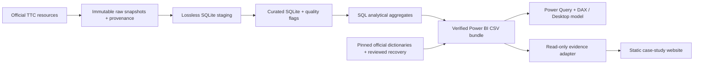

# TTC Delay Patterns

**Why incident frequency and recorded duration tell different stories.**

An end-to-end analysis of Toronto Transit Commission delay records, built with Python, SQLite and SQL, with verified Power BI reporting assets and an independently buildable case-study website.

> When, where, and how do recorded TTC delays recur—and what changes when we examine both incident frequency and recorded delay duration?

A count leaderboard can emphasize frequent short or zero-minute records while overlooking a smaller population contributing much more recorded duration. This project compares those measures while preserving source values, snapshot identity and uncertainty. Records are not independently verified unique disruptions; recorded minutes are not passenger-minutes or network-wide impact.

## Key findings

| Verified finding | What it demonstrates |
| --- | --- |
| **Bus:** 4,209 / 102,257 incidents (**4.12%**) exceed 60 minutes, contributing 853,656 / 2,163,102 minutes (**39.46%**). | Duration is concentrated among relatively few records. |
| **Subway:** 29,669 / 45,475 records (**65.24%**) report zero minutes. | Frequency and duration answer different questions; a recorded zero is retained, not treated as missing. |
| **Bus codes:** MFDV has **7,288 incidents / 871,387 minutes**; EFO has **18,178 incidents / 251,714 minutes**. | The more frequent category is not necessarily the largest contributor to minutes. |

MFDV overlaps the long-duration population: do not add their impacts. Monthly evidence also shows YU leading Subway counts in all 20 months, with BD leading minutes in three. [Verified temporal evidence](reports/temporal_persistence_evidence.md).

## Stack and architecture

Python handles acquisition, checksums, strict CSV parsing, transactions and verification. SQLite stores lossless staging and explicitly selected curated snapshots. SQL defines transformations and analytical aggregates. `unittest` exercises preservation, recovery and reconciliation. Power Query/DAX provide the reporting implementation; React, TypeScript, Vite and Tailwind render the independent website.



The diagram describes the data/reporting assets; it does not assert a publicly deployed Power BI dashboard. The website build never requires acquisition, Python or SQLite.

## Sources and observation windows

| Mode | Observed dates | Records | Recorded minutes |
| --- | --- | ---: | ---: |
| [Bus](https://open.toronto.ca/dataset/ttc-bus-delay-data/) | 2025-01-01–2026-08-31 | 102,257 | 2,163,102 |
| [Subway](https://open.toronto.ca/dataset/ttc-subway-delay-data/) | 2025-01-01–2026-08-31 | 45,475 | 122,071 |
| [Streetcar](https://open.toronto.ca/dataset/ttc-streetcar-delay-data/) | 2025-01-01–2026-08-31 | 23,703 | 416,513 |
| [LRT](https://open.toronto.ca/dataset/ttc-lrt-delay-data/) | 2025-12-07–2026-08-31 | 4,569 | 38,829 |
| **Total** | **Mode-dependent** | **176,004** | **2,740,515** |

The first three modes have 608 observed dates across 20 months. LRT has 267 observed dates within a 268-day span; **2026-01-23 has no observed records**. There are no invalid incident dates in the selected snapshots. A reporting gap is not a zero-delay service day. Coverage is not proof of completeness or equal service exposure.

[Snapshot selection](config/curated_snapshots.json), [provenance](data/provenance/) and SHA-256 checks identify the exact inputs. A newer download is a new candidate snapshot, not a substitute for the frozen evidence.

## Repository map

```text
config/               Explicit snapshots and reviewed description recovery
scripts/              Acquisition, staging, curation, analysis and export tools
sql/                  SQLite schemas, transformations and analytical queries
tests/                Offline fixtures and regression tests
references/           Immutable official dictionaries and provenance
reports/              Historical and current verification / analytical evidence
docs/                 Contracts, architecture and documentation index
data/provenance/      Tracked acquisition records
results/power_bi/     Approved ten CSVs, typed results and manifest
website/              Standalone application, full narrative and chart evidence
```

`data/raw/`, `data/local/` and intermediate analytical outputs remain local and ignored. No analytical paths were reorganized. Start with the [documentation index](docs/README.md).

## Setup and reproduction

Use Python **3.10+** with SQLite **3.38+ and JSON functions**; tested here with Python 3.11.9 / SQLite 3.45.1. `certifi` is used only for verified HTTPS acquisition. Analysis and tests use the standard library.

From the repository root, on macOS/Linux:

```sh
python3 -m venv .venv
source .venv/bin/activate
python3 -m pip install -r requirements.txt
python3 -c "import sqlite3; print(sqlite3.sqlite_version)"
python3 -B -m unittest discover -s tests -v
python3 -B scripts/export_website_evidence.py --check
```

**A fresh clone does not contain raw CSVs or SQLite databases.** The checked-in website evidence and Power BI bundle can be reviewed without them. Tests use offline fixtures and checked-in evidence; they need neither the raw snapshots nor network access. The current suite has **79 passing tests: 76 analytical/enrichment tests and three website-adapter tests**.

<details>
<summary><strong>Rebuild the frozen analysis when the original four raw snapshots are available</strong></summary>

Restore the exact original CSVs at the relative paths recorded in the four successful provenance files; checksum mismatches are rejected. Preserve the failed acquisition record as history, but do not ingest it. This recipe builds disposable outputs and does not overwrite the approved databases or exports:

```sh
RUN_DIR=$(mktemp -d)
python3 -B scripts/init_storage.py --database "$RUN_DIR/staging.sqlite3"
python3 -B scripts/ingest_staging.py --database "$RUN_DIR/staging.sqlite3" --provenance \
  data/provenance/20261021T190204614685Z__subway.json \
  data/provenance/20261021T190548363172Z__bus.json \
  data/provenance/20261021T190549738480Z__streetcar.json \
  data/provenance/20261021T190550293696Z__lrt.json
python3 -B scripts/verify_staging.py --database "$RUN_DIR/staging.sqlite3"
python3 -B scripts/build_curated.py --source "$RUN_DIR/staging.sqlite3" \
  --selection config/curated_snapshots.json --output "$RUN_DIR/curated.sqlite3"
python3 -B scripts/run_core_analysis.py --database "$RUN_DIR/curated.sqlite3" \
  --staging "$RUN_DIR/staging.sqlite3" --output "$RUN_DIR/core"
python3 -B scripts/run_temporal_analysis.py --database "$RUN_DIR/curated.sqlite3" \
  --staging "$RUN_DIR/staging.sqlite3" --output "$RUN_DIR/temporal"
python3 -B scripts/export_power_bi.py --database "$RUN_DIR/curated.sqlite3" \
  --staging "$RUN_DIR/staging.sqlite3" --core "$RUN_DIR/core" \
  --temporal "$RUN_DIR/temporal" --output "$RUN_DIR/power_bi"
```

Ingest in the listed order because the frozen selection references local snapshot IDs 1–4. The recipe was executed against the preserved snapshots during website validation. Exact database-byte hashes can depend on runtime/implementation; source-row and analytical reconciliation remain mandatory.

</details>

<details>
<summary><strong>Acquire newer public data separately</strong></summary>

```sh
python3 -B scripts/acquire_subway_tracer.py --mode subway
```

The existing parameterized acquisition script also accepts `bus`, `streetcar` and `lrt`. It resolves the selected resource from `source_manifest.json`, verifies TLS with certifi and writes a new timestamped snapshot/provenance pair. This is **not** a command to reproduce the frozen results or promote a new snapshot. Review coverage, schema and revised content before explicit selection. Do not run `discover_metadata.py` merely to rebuild old results: it refreshes the comprehensive catalog manifest.

The acquisition command was inspected, not executed in the website task. Its optional producer-side privacy cleanup is deferred; review new provenance before tracking it. There is no scheduled update service.

</details>

### Build the website independently

Use Node **22.12+** (tested with 26.7.0), or the Vite-supported Node 20.19 release line:

```sh
cd website
npm ci
npm run typecheck
npm run lint
npm run build
npm run dev
```

Vite prints the local URL. The standalone production output is `website/dist/`. Vercel configuration is documented in [website/README.md](website/README.md); **no site is deployed yet**. Updating chart evidence is an explicit read-only Python projection before committing a new reviewed bundle, not a deployment step.

## Quality and reporting status

Raw fields remain recoverable through snapshot and row identity. **770 records in 383 duplicate-candidate groups** are flagged and retained. Missing labels, weekday/date conflicts, unknown codes and long durations are preserved with analysis-specific eligibility. Zero-minute records remain incidents.

Mode-specific official dictionaries describe **165,124 / 176,004 records (93.82%)** after 56 checksum-bound, reversible en-dash recoveries. Original dictionary bytes and source typos remain intact. The 137 unresolved dimension entries use readable `Description unavailable` labels without invented meanings. [Recovery evidence](reports/code_description_encoding_recovery.md) · [display fallback](reports/code_display_fallback.md).

The [Power BI contract](docs/power_bi_data_contract.md) specifies ten tables and thirteen relationships; [54 DAX definitions](power_bi/measures.dax), [Power Query imports](power_bi/import_queries.pq), [validation queries](power_bi/validation_queries.dax) and [Desktop instructions](docs/power_bi_desktop_build.md) are included. The author previously reported Desktop model validation complete. No PBIX, screenshots or public dashboard URL are supplied here, so this repository does not independently verify publication. Historical build notes retain their original status.

## Read further

- [Complete case-study source and local/deployment instructions](website/README.md) — public website URL pending.
- [Content coverage and editorial review](website/docs/content-coverage.md).
- [Cleaning rules](docs/cleaning_validation_rules.md) · [snapshot versioning](docs/snapshot_versioning.md).
- [Core findings](reports/core_analytical_findings.md) · [temporal persistence](reports/temporal_persistence_evidence.md).

Independent work by **Ishtiyak Ahmed**, not affiliated with or endorsed by TTC. Contains information licensed under the [Open Government Licence – Toronto](https://open.toronto.ca/open-data-licence/). Data attribution is not a software licence grant.
